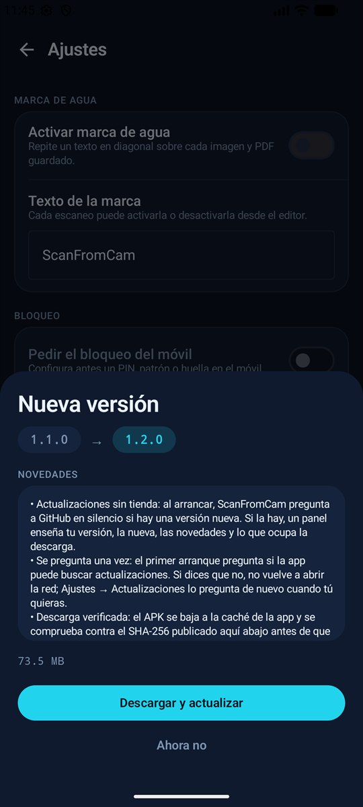
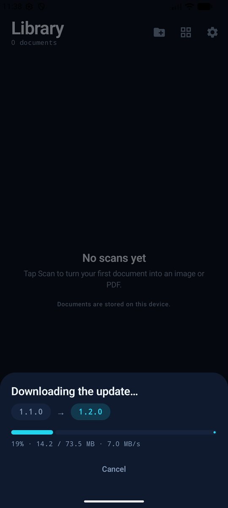
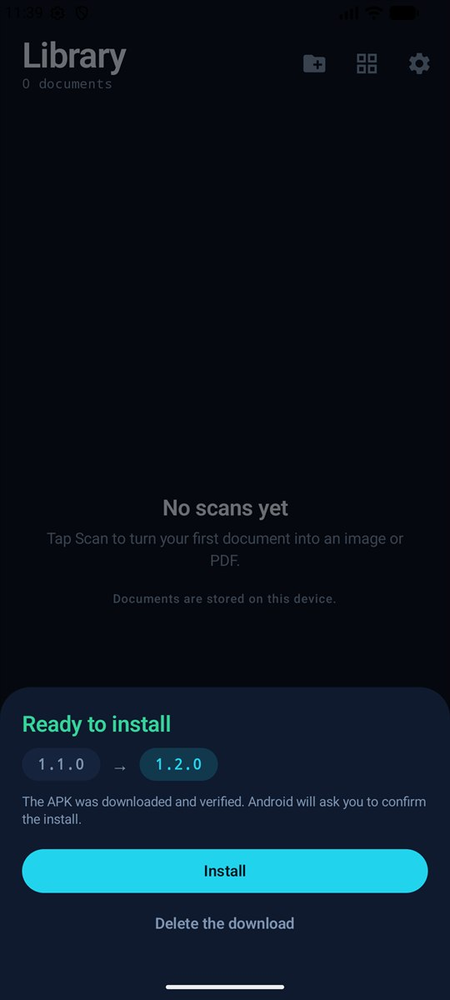
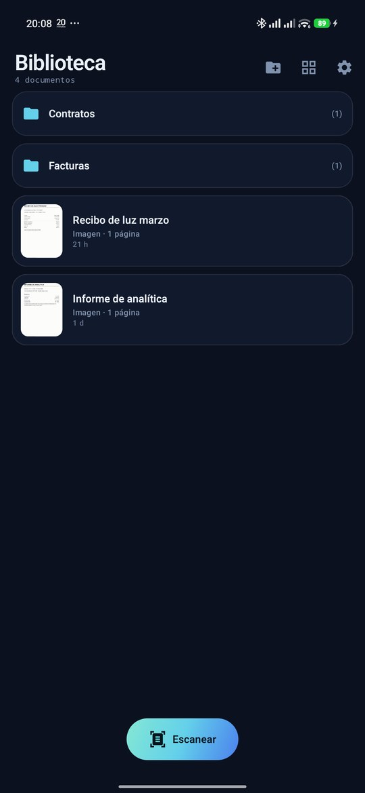
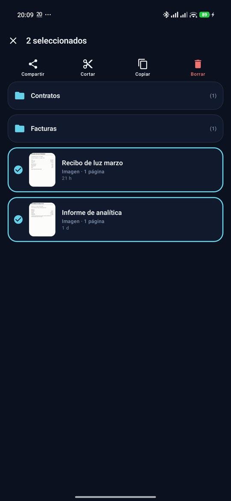
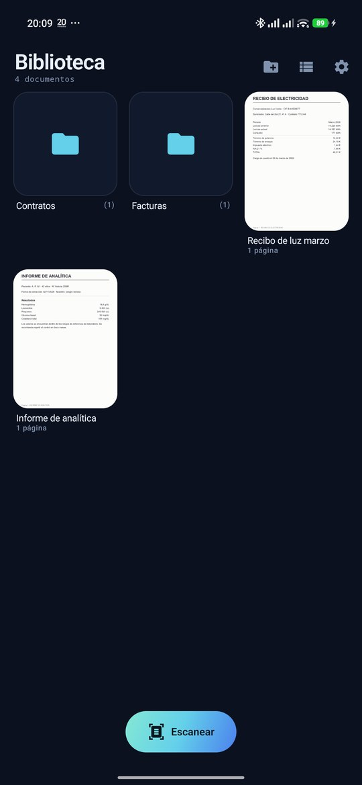
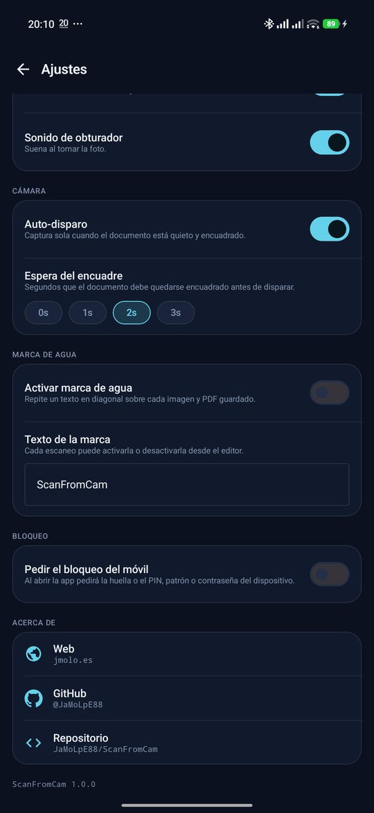
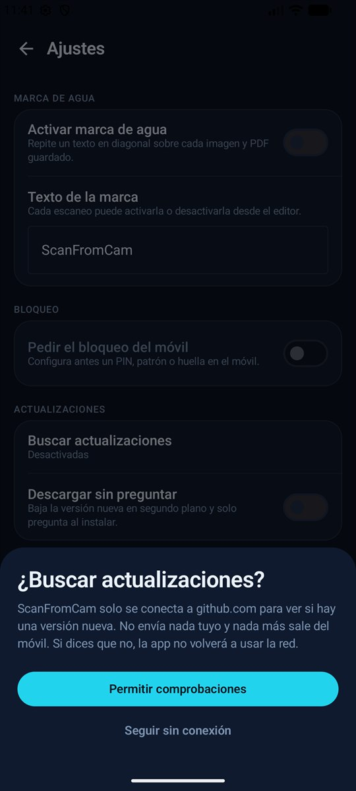
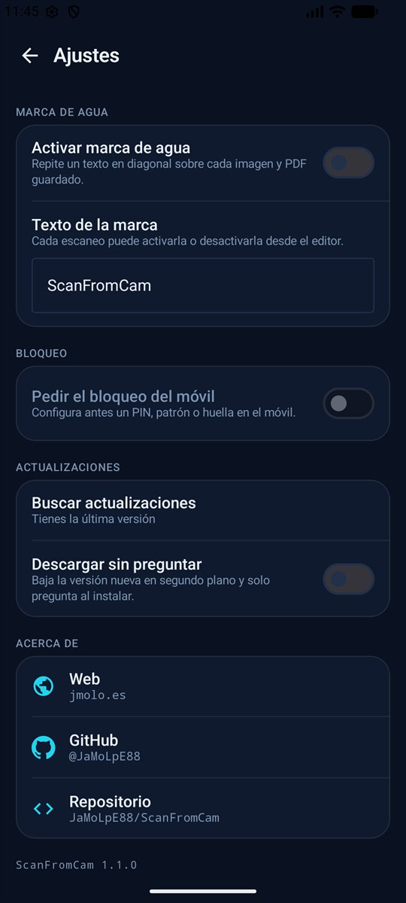

<p align="center">
  
</p>

<p align="center">
  <a href="https://github.com/JaMoLpE88/ScanFromCam"></a>
  <a href="LICENSE"></a>
  
  
  
</p>

<h1 align="center">ScanFromCam</h1>

<p align="center">
  <a href="README.md">English</a> · <b>Español</b>
</p>

<p align="center">
  Convierte la cámara del móvil en un escáner de documentos: captura, endereza,
  limpia y exporta a imagen o a PDF con texto. Libre, open source, sin conexión por
  defecto, sin anuncios, sin cuentas y sin límites.
</p>

---

## Qué hace

Apuntas la cámara a un folio. ScanFromCam encuentra sus cuatro esquinas, espera
a que el encuadre esté quieto antes de disparar y te deja la página en un lienzo
oscuro donde puedes corregir el recorte, girarla, reconocer su texto y elegir el
acabado: **Original** (tal cual se capturó) u **Optimizar** (limpio como un
escaneo real). Las páginas se apilan en un documento que se guarda como un JPG
por página o como un PDF con capa de texto seleccionable.

Los escaneos van a la biblioteca, donde puedes agruparlos en carpetas, moverlos o
duplicarlos entre ellas y alternar entre lista y rejilla de miniaturas.

Todo ocurre en el dispositivo. La única petición de red que la app puede hacer es
la comprobación de actualizaciones contra sus propias releases de GitHub, y solo si
tú la autorizas; si dices que no, no abre ni un socket.

<p align="center">
  
  
  
</p>
<p align="center">
  <em>Biblioteca · detección de bordes en vivo y auto-disparo · editor con el acabado optimizado</em>
</p>

## Novedades

**Actualizaciones sin tienda.** ScanFromCam no está en Google Play, así que la 1.2.0
le enseña a actualizarse sola. Al primer arranque pregunta si la app puede mirar en
`github.com/JaMoLpE88/ScanFromCam`; si dices que sí, cada arranque consulta en
segundo plano la última release y no dice nada salvo que haya novedad. Cuando la
hay, un panel enseña tu versión, la nueva, las novedades y lo que ocupa la
descarga; el APK se baja a la caché de la app, se comprueba contra el SHA-256
publicado con la release y se entrega al instalador de Android. *Descargar sin
preguntar* en Ajustes lo baja solo y únicamente se detiene para pedir la
instalación.

<p align="center">
  
  
  
</p>
<p align="center">
  <em>Nueva versión · descarga en segundo plano · entrega al instalador</em>
</p>

**Carpetas y contadores.** Agrupa los escaneos en carpetas (un solo nivel, sin
subcarpetas). La cabecera de la biblioteca cuenta *todos* los documentos del
dispositivo, incluidas las carpetas, y cada carpeta muestra su propio número. Si
borras una carpeta se va con ella todo lo que contiene, y el aviso lo dice antes
de hacerlo.

**Seleccionar, cortar, copiar, pegar.** Mantén pulsado un documento para entrar
en selección, elige los que quieras y actúa sobre todos a la vez: compartir,
borrar, **cortar** o **copiar**. Navega a otra carpeta y **pega**. La copia
duplica las filas *y* los ficheros, así que borrar el original deja la copia
intacta.

**Lista o miniaturas.** Un botón cambia la biblioteca entre filas y rejilla de
miniaturas, y la elección se recuerda.

**Deslizar para borrar.** Arrastra una fila a la izquierda: se queda apartada
mostrando la papelera mientras sale la confirmación, y vuelve a su sitio si
cancelas.

**Bloqueo con el propio móvil.** Ajustes → Bloqueo pide la huella, el PIN, el
patrón o la contraseña del dispositivo antes de enseñar nada. No se crea ningún
PIN nuevo ni se guarda nada: es el diálogo del sistema, y la app se vuelve a
bloquear al salir de ella.

<p align="center">
  
  
  
  
</p>
<p align="center">
  <em>Carpetas y contadores · selección con cortar y copiar · vista de miniaturas · bloqueo</em>
</p>

## Pantallas

<table>
  <tr>
    <td align="center"><br><sub>Imagen o PDF</sub></td>
    <td align="center"><br><sub>Arrastra un vértice o un lado entero</sub></td>
    <td align="center"><br><sub>Lupa de 2,5× bajo el dedo</sub></td>
    <td align="center"><br><sub>Ponle nombre y guarda</sub></td>
  </tr>
  <tr>
    <td align="center"><br><sub>Lee, comparte o abre el PDF</sub></td>
    <td align="center"><br><sub>Renombrar, compartir, borrar</sub></td>
    <td align="center"><br><sub>Idioma, sonido, auto-disparo</sub></td>
    <td align="center"><br><sub>Original vs Optimizar</sub></td>
  </tr>
</table>

## Funciones

**Captura**

- Detección de bordes en vivo sobre el fotograma completo, con un cuadrilátero
  suavizado por esquina que no tiembla.
- Auto-disparo: el marco se pone verde cuando la página está encuadrada y con
  cobertura suficiente, espera la demora que elijas (0–3 s) y dispara. Se pausa
  mientras el móvil se mueve, así que nunca hace una foto borrosa.
- Obturador manual siempre disponible; el beep y el sonido de obturador se
  pueden apagar.

**Edición**

- Recorte con cuatro vértices o arrastrando un lado entero, moviendo el borde que
  corresponde, con una lupa de 2,5× que sigue al dedo.
- Rotar, retomar, añadir más páginas y quitar las que no quieras.
- Original / Optimizar por página, calculado al pedirlo para que el editor abra
  al instante.
- Extracción de texto en el dispositivo, para copiarlo o para el PDF.

**Optimizar** — el pase de foto a escaneo, en este orden:

1. estimar la iluminación de la escena y dividirla;
2. fijar el negro y el blanco al papel y la tinta de esta página, lo que además
   neutraliza la dominante de color;
3. estirar la curva de tonos, recuperar altas luces y afilar sólo donde hay un
   borde, para que el papel liso siga liso;
4. devolver el croma, porque aplanar la luminancia lava el color.

**Biblioteca**

- Carpetas planas: crear, renombrar, borrar (con todo lo que contienen, tras un
  aviso), contador por carpeta y contador total en la cabecera.
- Mantener pulsado para seleccionar uno o varios documentos y compartirlos,
  borrarlos, cortarlos o copiarlos; pegarlos en cualquier carpeta.
- Vista de lista o de miniaturas, recordada entre arranques.
- Deslizar una fila a la izquierda para borrarla; la fila se queda abierta hasta
  que confirmes.

**Guardar y compartir**

- Un JPG por página, o un PDF cuya capa de texto es realmente seleccionable y
  buscable (texto invisible sobre la imagen).
- Nombrar el documento, compartirlo (uno o varios a la vez), renombrarlo, abrir
  el PDF y borrarlo.

**Privacidad**

- **Sin red salvo que la pidas.** La única petición que la app puede hacer es leer
  el JSON de sus propias releases de GitHub, y solo si lo autorizas en el primer
  arranque; Ajustes → Actualizaciones lo vuelve a desactivar. No hay nada más que
  filtrar.
- Sin cuentas, sin analítica, sin informes de fallos y sin SDK de anuncios.
- Los documentos viven en el almacenamiento privado de la app y sólo salen del
  dispositivo si los compartes tú. Otras apps y gestores de archivos no pueden
  leerlos, con o sin el bloqueo.
- Bloqueo opcional con la credencial del propio móvil (huella, PIN, patrón o
  contraseña); la app lo pide antes de enseñar nada y no guarda ningún PIN
  adicional.

<p align="center">
  
</p>
<p align="center">
  <em>Toda la superficie de red: una pregunta, en el primer arranque</em>
</p>

## Gratis es gratis

- **Sin anuncios.** Ni banner, ni splash, ni "mira un vídeo para desbloquear".
- **Sin suscripción, sin créditos y sin muro de pago.** Todo lo que hay en este
  repositorio está disponible para todo el mundo.
- **Sin límite de páginas ni de documentos.** Escanea 2 páginas o 200.
- **Sin marca de agua forzada.** Hay un sello diagonal opcional, con el texto que
  tú escribas, que viene **desactivado**; la página es tuya.
- **Código abierto.** Apache-2.0: léelo, compílalo, hazle un fork, publícalo.

## Idiomas

La interfaz viene en **español** e **inglés**, y se cambia en caliente desde
Ajustes. Añadir otro idioma es implementar `Texts`
(`core/Texts.kt`).

<table>
  <tr>
    <td align="center"><br><sub>English</sub></td>
    <td align="center"><br><sub>English</sub></td>
    <td align="center"><br><sub>English</sub></td>
  </tr>
</table>

## Descargar

Los APK firmados van adjuntos en cada [release](https://github.com/JaMoLpE88/ScanFromCam/releases):

- `ScanFromCam-1.2.0-arm64-v8a.apk` — móviles y tablets (casi cualquier dispositivo actual).
- `ScanFromCam-1.2.0-x86_64.apk` — emuladores y tablets x86.

Descarga el APK y ábrelo en el móvil; Android pedirá permiso para instalar desde esa
fuente. Sin cuenta de tienda y sin registro. A partir de la 1.2.0 la app se actualiza
sola desde las releases siguientes, así que solo hay que instalarla a mano una vez.

<p align="center">
  
</p>
<p align="center">
  <em>Ajustes → Actualizaciones: buscar ahora, o dejar que se baje sola la siguiente</em>
</p>

## Compilar

Requisitos: JDK 21 y Android SDK 37. Indica dónde está el SDK con `sdk.dir` en
`local.properties` (lo escribe Android Studio) o con la variable `ANDROID_HOME`.

```bash
git clone https://github.com/JaMoLpE88/ScanFromCam.git
cd ScanFromCam
./gradlew :app:assembleDebug
```

La build de release va minificada y genera un APK por ABI (la librería nativa de
OpenCV pesa, así que `arm64-v8a` y `x86_64` se compilan por separado). Para una build
instalable rápida, firmada con la clave de debug:

```bash
./gradlew :app:assembleStaging
```

## Pruebas

- `./gradlew :app:testDebugUnitTest` — 61 tests unitarios: geometría y orden del
  cuadrilátero, suavizado, ventana de estabilidad, decisión de auto-disparo,
  manejo del recorte, rotación, maquetación de la marca de agua, nombres de
  fichero, detección de idioma, tipos MIME al compartir y el actualizador (orden de
  versiones, elección del APK por ABI, extracción de novedades y digests).
- `./gradlew :app:connectedDebugAndroidTest` — 16 tests instrumentados: detección
  sobre fotos sintéticas, refinado de esquinas, el pipeline completo de captura,
  recorte y optimización, PDF con y sin capa de texto, PDFs grandes en streaming
  y carpetas (mover, copiar y borrar con su contenido).

## Estructura

```
app/src/main/java/com/scanfromcam/
  core/            nombres, imágenes, idioma, textos, marca de agua, sonidos, compartir, bloqueo
  domain/          modelos, geometría del cuadrilátero, contrato del repositorio
  data/            pipeline OpenCV, SQLite, OCR, PDF
  feature/
    library/       carpetas, selección, cortar/copiar/pegar, lista o rejilla
    format/        imagen o PDF
    capture/       cámara, detección en vivo, auto-disparo
    editor/        recorte, lupa, acabados, texto
    viewer/        leer, compartir, renombrar, borrar
    updates/       panel de actualización: permiso, novedades, progreso, instalar
  ui/              pantalla de bloqueo y widgets compartidos
  ui/theme/        tokens de diseño
```

## Cómo funciona el escaneo

- **Detección** (`data/Cv.kt`): dos generadores de candidatos independientes, los
  contornos de borde y la mancha brillante del papel, puntuados por área,
  rectangularidad, soporte real de borde, brillo del papel y contraste con el
  entorno; se descartan los cuadriláteros cortados por el encuadre, porque un
  folio se ve entero.
- **Rectificación**: ajuste de mínimos cuadrados por lado, re-intersección de las
  cuatro rectas y deformación de perspectiva con prefiltro al reducir, para que
  los trazos finos no hagan aliasing.
- **Optimizar**: el pase de iluminación / punto blanco / contraste local / croma
  descrito arriba.
- **OCR**: reconocimiento de texto de ML Kit en el dispositivo y capa de texto
  invisible en el PDF.

## Terceros

AndroidX, Jetpack Compose, CameraX (Apache-2.0) · OpenCV 4 (Apache-2.0) ·
ML Kit Text Recognition (términos de Google) · Coil (Apache-2.0).

## Pruebas manuales

Hay una guía paso a paso para probar la app en un móvil real en
[docs/TESTING.md](docs/TESTING.md).

## Licencia

[Licencia Apache 2.0](LICENSE) © 2026 JaMoLpE88.
