<p align="center">
  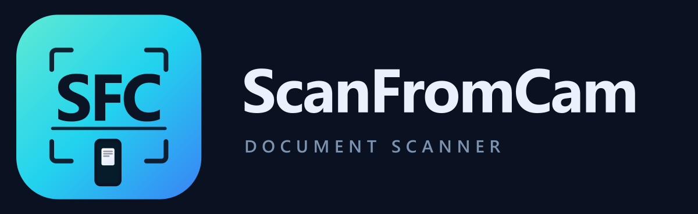
</p>

<p align="center">
  <a href="https://github.com/JaMoLpE88/ScanFromCam"></a>
  <a href="LICENSE"></a>
  
  
  
</p>

<h1 align="center">ScanFromCam</h1>

<p align="center">
  <b>English</b> · <a href="README.es.md">Español</a>
</p>

<p align="center">
  Turn your phone camera into a document scanner: capture, straighten, clean and
  export to image or searchable PDF. Free, open source, offline by default, no ads,
  no accounts, no limits.
</p>

---

## What it does

Point the camera at a sheet of paper. ScanFromCam finds its four corners, waits
until the frame is steady and the text is in focus, and gives you the page on a dark canvas
where you can fix the crop, rotate it, recognise its text and pick the finish:
**Original** (as captured) or **Optimize** (cleaned like a real scan). Pages
stack into a document you can save as one JPG per page or as a PDF with a
selectable text layer.

Saved scans land in the library, where you can group them in folders, move or
duplicate them between folders and switch between a list and a thumbnail grid.

Everything happens on the device. The only network request the app can make is the
update check against its own GitHub releases, and only after you allow it; say no
and it never opens a socket.

<p align="center">
  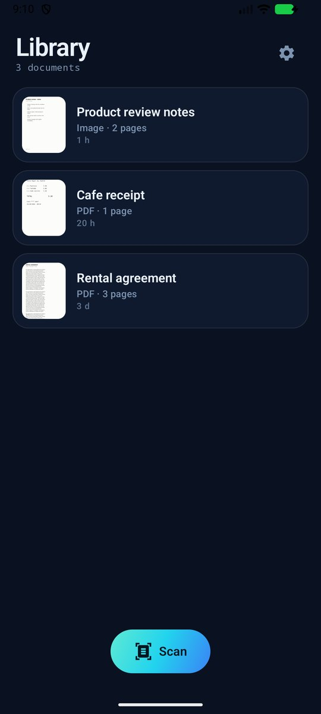
  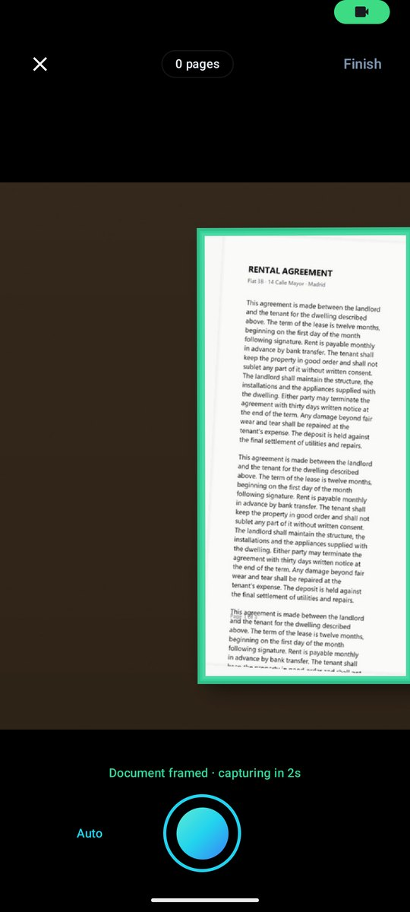
  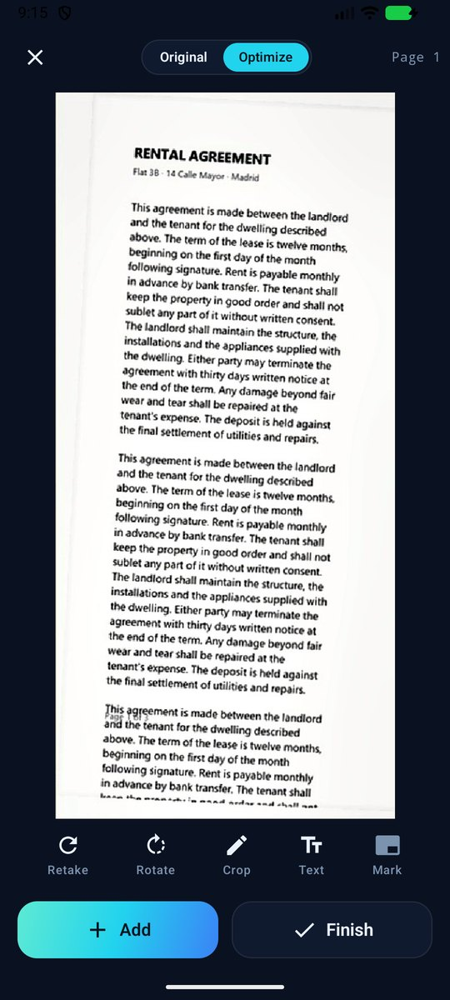
</p>
<p align="center">
  <em>Library · live edge detection and auto capture · editor with the optimized finish</em>
</p>

## What's new

**Release notes you can read again.** Settings now has *What's new* under Updates,
and the version number at the bottom opens it too: the same notes the update sheet
showed, with nothing asked of the network.

**The crop loupe aims where you will let go.** It used to magnify whatever was under
the finger, so the corner landed a few pixels away from what you had lined up. Now
it magnifies the corner — or the point of the side — that is being placed, so
letting go leaves the crop exactly where the loupe showed it.

**It shoots when the page is in focus.** Auto capture used to check only that the
phone was still; now it also measures how crisp the page reads. While the text
looks soft the strip says *Focus the document* and the shutter waits, so the photo
that gets stored is the one that was in focus on screen. A blank sheet is never
blamed for having nothing written on it, and the manual shutter is never blocked.

**The side you drag settles on the real edge.** Let go of a side in the crop editor
and it looks for the border under it, a few pixels either way, and moves onto it.
The median of what it finds wins, so one dark speck cannot drag the crop.

**Black and white pages weigh less.** When a page has no colour worth keeping —
type on paper, no stamp, no signature — the optimized version is stored in one
channel: same picture, around a third fewer bytes, and the flat look of a scan.
Anything with colour keeps all three.

**Flatter paper around the ink.** The illumination map is now estimated with the
writing taken out of it, which removes the grey halo that used to hug the letters
and softens wrinkle shadows without eating the detail.

**Updates without a store.** ScanFromCam is not on Google Play, so 1.2.0 teaches it
to update itself. The first launch asks whether the app may look at
`github.com/JaMoLpE88/ScanFromCam`; if you say yes, every launch checks the latest
release in the background and stays silent unless there is something new. When
there is, a sheet shows your version, the new one, what changed and the download
size; the APK is fetched to the app's cache, checked against the SHA-256 published
with the release, and handed to the Android installer. *Download without asking*
in Settings fetches it on its own and only stops to ask for the install.

<p align="center">
  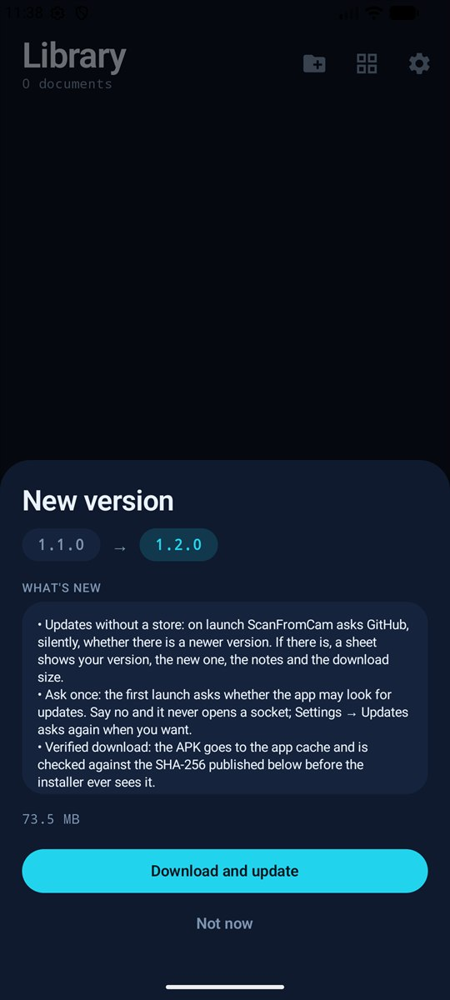
  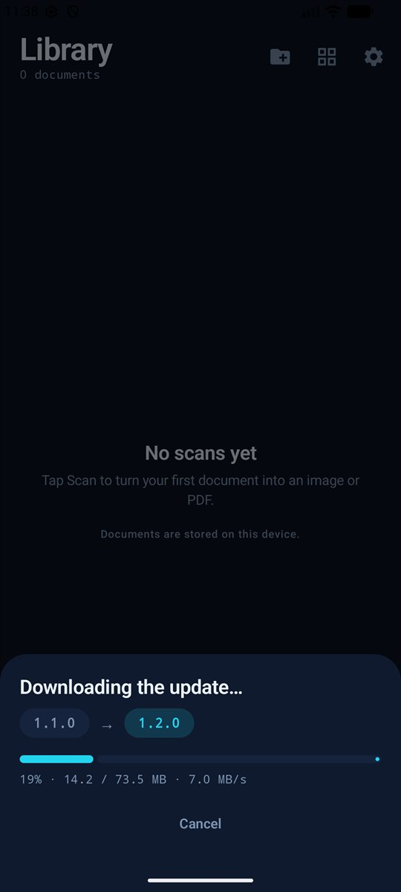
  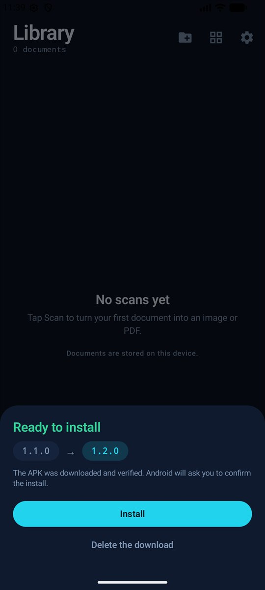
</p>
<p align="center">
  <em>New version · background download · install hand-off</em>
</p>

**Folders and counters.** Group the scans in folders (one level, no nesting).
The library header counts *every* document on the device, folders included, and
each folder shows its own number. Delete a folder and everything inside goes
with it, after the dialog says so.

**Select, cut, copy, paste.** Long-press a document to start selecting, pick as
many as you want, and act on all of them at once: share, delete, **cut** or
**copy**. Navigate to another folder and **paste**. A copy duplicates the rows
*and* the files, so deleting the original leaves the copy intact.

**List or thumbnails.** One button switches the library between rows and a
thumbnail grid, and the choice is remembered.

**Swipe to delete.** Drag a row to the left: it stays pushed aside showing the
bin while the confirmation is up, and slips back if you cancel.

**App lock with the phone's own lock.** Settings → Lock asks for the device
fingerprint, PIN, pattern or password before showing anything at all. No extra
PIN is created and nothing new is stored; it is the system prompt, and the app
locks itself again when you leave it.

<p align="center">
  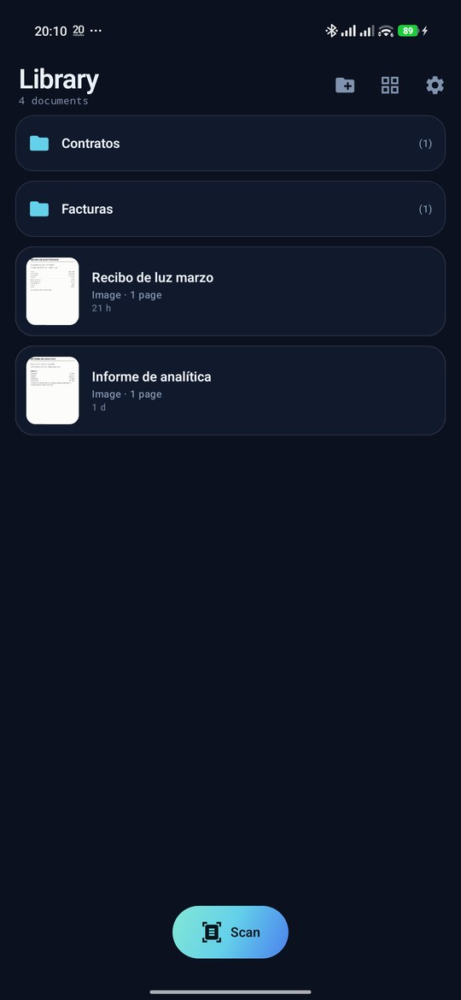
  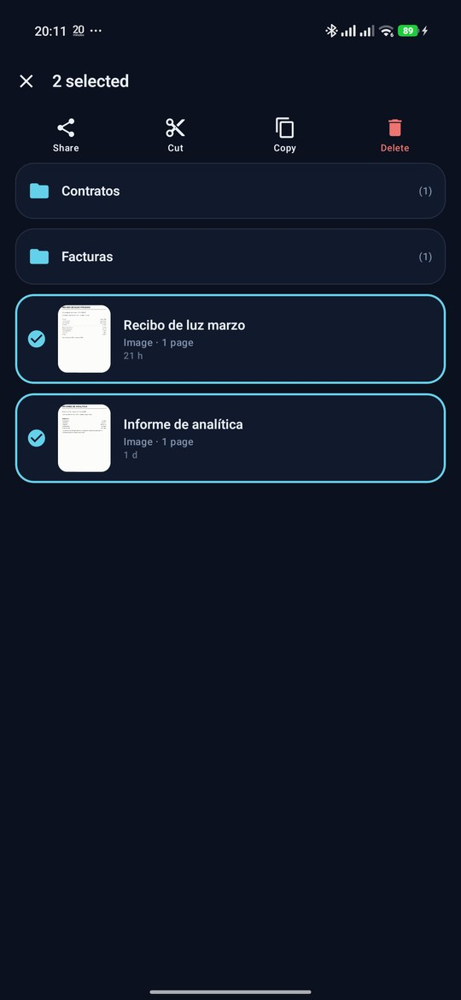
  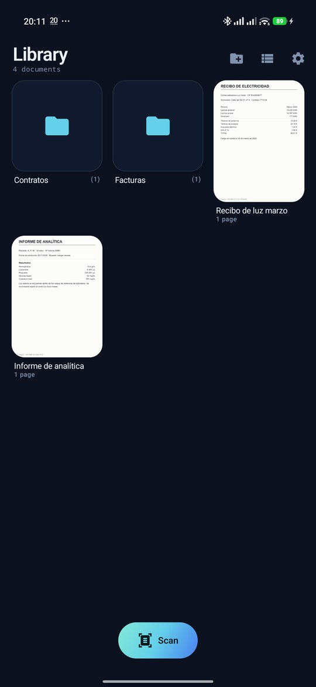
  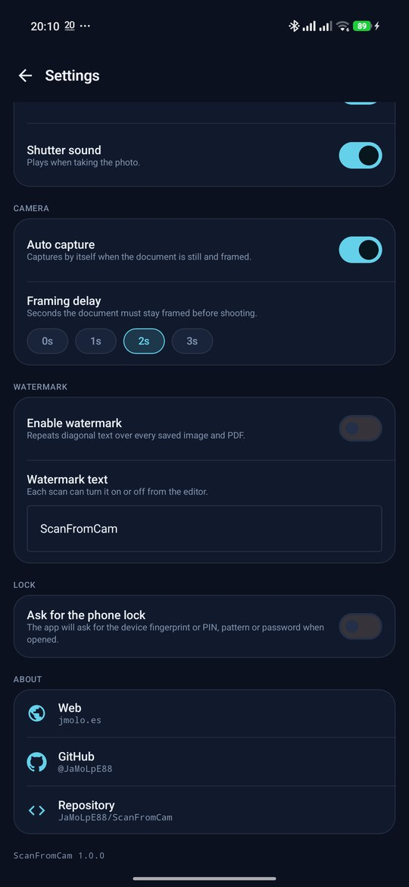
</p>
<p align="center">
  <em>Folders and counters · selection with cut and copy · thumbnail view · app lock</em>
</p>

## Screens

<table>
  <tr>
    <td align="center">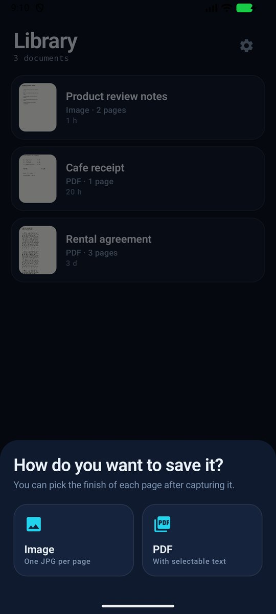<br><sub>Pick image or PDF</sub></td>
    <td align="center">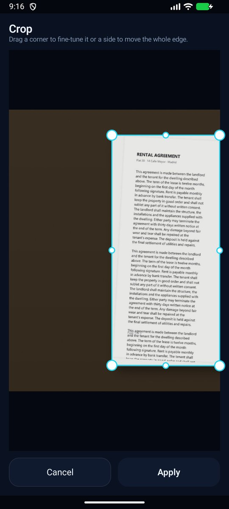<br><sub>Drag a corner or a whole side</sub></td>
    <td align="center">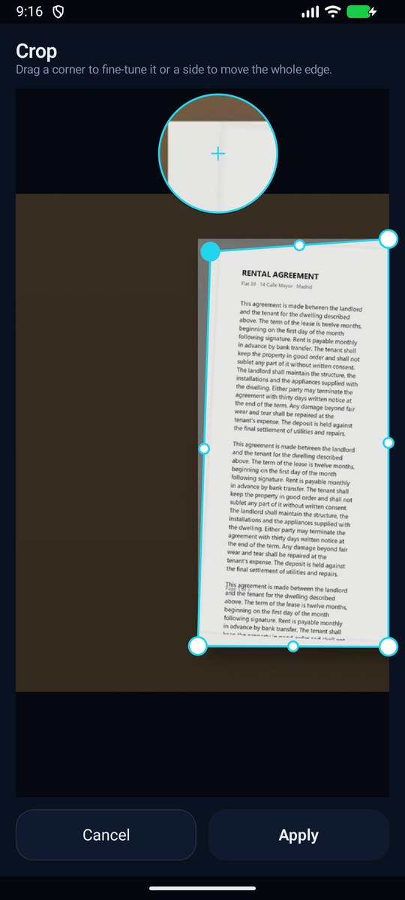<br><sub>2.5× magnifier under the finger</sub></td>
    <td align="center">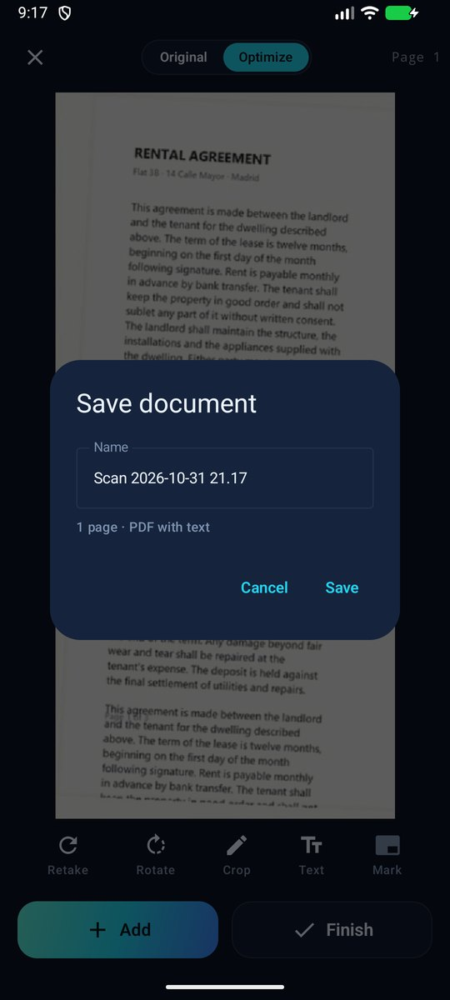<br><sub>Name it and save</sub></td>
  </tr>
  <tr>
    <td align="center">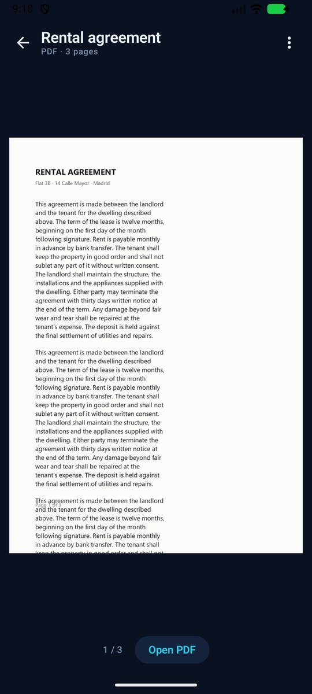<br><sub>Read, share or open the PDF</sub></td>
    <td align="center">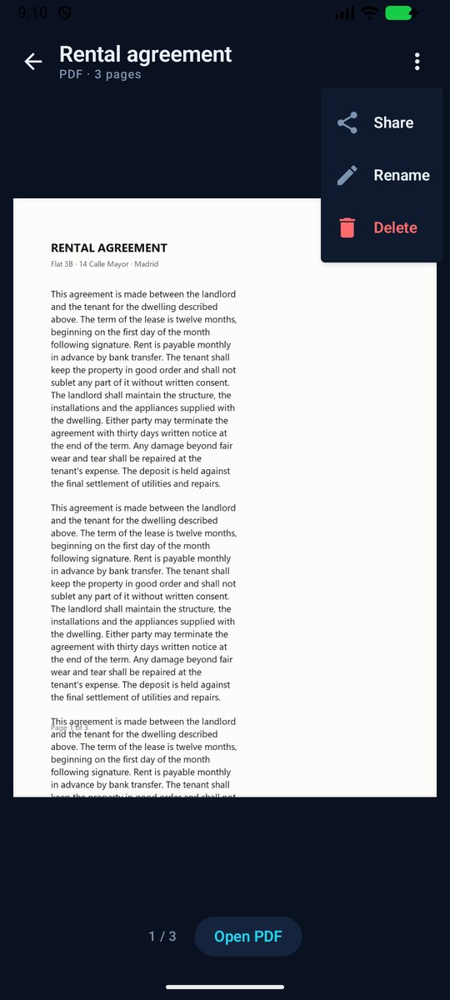<br><sub>Rename, share, delete</sub></td>
    <td align="center"><br><sub>Language, sound, auto capture</sub></td>
    <td align="center">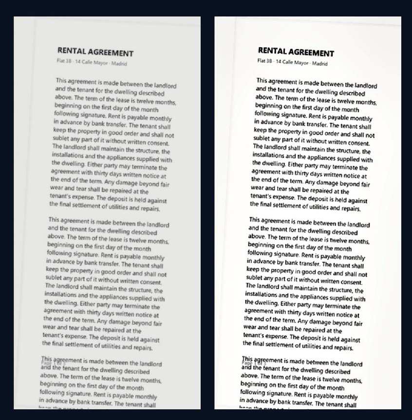<br><sub>Original vs Optimize</sub></td>
  </tr>
</table>

## Features

**Capture**

- Live edge detection on the full camera frame, with a corner-smoothed quad that
  does not jitter.
- Auto capture: the frame turns green when the page is framed and covered, waits
  the delay you choose (0–3 s) and shoots. It pauses while the phone moves and
  while the page reads as soft, so it never takes a blurred photo.
- Manual shutter always available; beep and shutter sound can be turned off.

**Edit**

- Crop with four corner handles or by dragging a whole side, both moving the
  edge it belongs to, with a 2.5× magnifier that follows your finger. A side
  released near a border settles onto it.
- Rotate, retake, add more pages, remove the ones you do not want.
- Original / Optimize per page, computed on demand so the editor opens instantly.
- Text extraction on device, then copy the text or keep it for the PDF.

**Optimize** — the photo-to-scan pass, in this order:

1. estimate the room illumination, with the writing taken out of the estimate,
   and divide it out;
2. pin the black and white points to this page's ink and paper, which also
   neutralises a colour cast;
3. stretch the tone curve, lift the highlights and sharpen only where there is
   an edge, so plain paper stays flat;
4. bring the chroma back, because flattening luminance washes colour out.

**Library**

- Flat folders: create, rename, delete (with everything inside, after a
  warning), a per-folder count and a total count in the header.
- Long-press to select one or many documents and share, delete, cut or copy
  them; paste them into any folder.
- List or thumbnail view, remembered between launches.
- Swipe a row left to delete it; the row stays open until you confirm.

**Save and share**

- One JPG per page, or a PDF whose text layer is really selectable and
  searchable (invisible text drawn over the image).
- Pages without colour are stored in one channel, so a sheet of black type takes
  about a third fewer bytes than the same page in full colour.
- Name the document, share it (one or several at once), rename it, open the PDF,
  delete it.

**Privacy**

- **No network unless you ask.** The only request the app can make is a JSON read of
  its own GitHub releases, and only after you allow it on first launch; Settings →
  Updates turns it off again. There is nothing else to leak to.
- No accounts, no analytics, no crash reporting, no ad SDK.
- Documents live in the app's private storage and never leave the device unless
  you share them yourself. Other apps and file managers cannot read them, with
  or without the app lock.
- Optional app lock with the phone's own credential (fingerprint, PIN, pattern
  or password); the app asks for it before showing anything and stores no extra
  PIN.

<p align="center">
  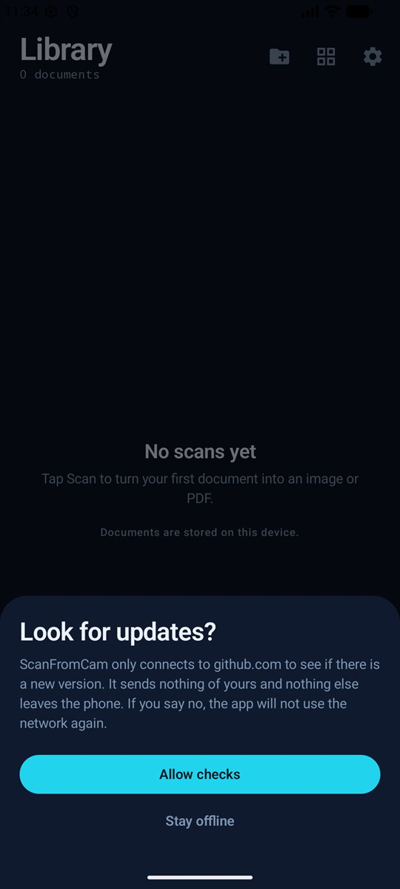
</p>
<p align="center">
  <em>The whole network surface: one question, on first launch</em>
</p>

## Free means free

- **No ads.** Not a banner, not a splash, not a "watch a video to unlock".
- **No subscription, no credits, no paywall.** Every feature in this repository
  is available to everyone.
- **No page or document limits.** Scan 2 pages or 200.
- **No forced watermark.** There is an optional diagonal stamp you can switch on
  and write yourself; it is **off by default** and the page is yours.
- **Open source.** Apache-2.0: read it, build it, fork it, ship it.

## Languages

The UI ships in **English** and **Spanish**, and can be switched at runtime from
Settings. More languages are a `Texts` implementation away
(`core/Texts.kt`).

<table>
  <tr>
    <td align="center">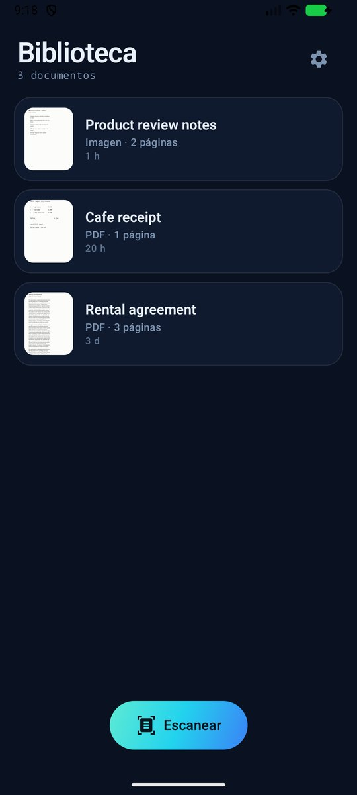<br><sub>Español</sub></td>
    <td align="center">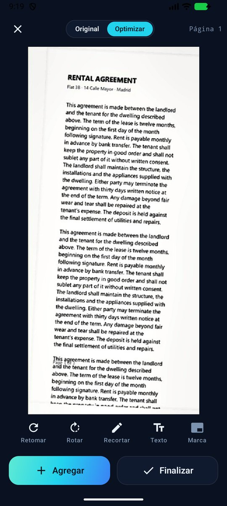<br><sub>Español</sub></td>
    <td align="center">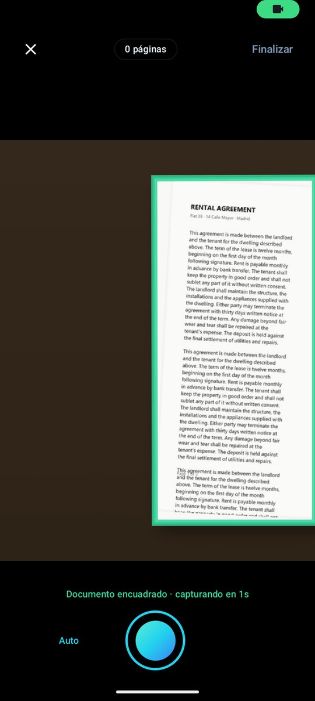<br><sub>Español</sub></td>
  </tr>
</table>

## Download

Signed APKs are attached to every [release](https://github.com/JaMoLpE88/ScanFromCam/releases):

- `ScanFromCam-1.3.1-arm64-v8a.apk` — phones and tablets (almost every current device).
- `ScanFromCam-1.3.1-x86_64.apk` — emulators and x86 tablets.

Download the APK and open it on the phone; Android will ask to allow installs from that
source. No store account, no sign-up. From 1.2.0 on, the app updates itself from
future releases, so you only sideload once.

<p align="center">
  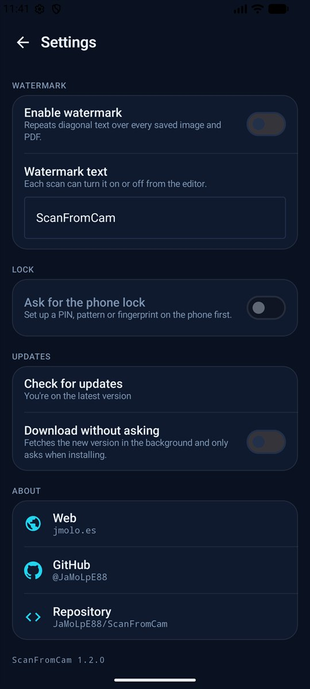
</p>
<p align="center">
  <em>Settings → Updates: check now, or let it fetch the next version by itself</em>
</p>

## Build

Requirements: JDK 21 and Android SDK 37. Point the build at your SDK with `sdk.dir` in
`local.properties` (Android Studio writes it) or the `ANDROID_HOME` environment variable.

```bash
git clone https://github.com/JaMoLpE88/ScanFromCam.git
cd ScanFromCam
./gradlew :app:assembleDebug
```

The release build is minified and produces one APK per ABI (the OpenCV native
library is big, so `arm64-v8a` and `x86_64` are built separately). For a quick installable
build signed with the debug key:

```bash
./gradlew :app:assembleStaging
```

## Tests

- `./gradlew :app:testDebugUnitTest` — 70 unit tests: quad geometry and ordering,
  quad smoothing, stability window, capture gating (frame, coverage, movement and
  focus), the focus threshold, crop handles, rotation, watermark layout, file
  naming, language detection, share MIME types, and the updater (version ordering,
  APK choice per ABI, release-note extraction, digests).
- `./gradlew :app:connectedDebugAndroidTest` — 21 instrumented tests: detection on
  synthetic photos, corner refinement, how crisp a page reads and how soft it has
  to be to be refused, a side settling onto its border, page storage in one
  channel, the whole capture → crop → optimize pipeline, PDF with and without a
  text layer, streaming builds of large PDFs, and folders (move, copy, delete).

## Project layout

```
app/src/main/java/com/scanfromcam/
  core/            names, images, language, texts, watermark, sounds, sharing, app lock
  domain/          models, quad geometry, repository contract
  data/            OpenCV pipeline, SQLite, OCR, PDF
  feature/
    library/       folders, selection, cut/copy/paste, list or grid
    format/        image or PDF
    capture/       camera, live detection, auto capture
    editor/        crop, magnifier, finishes, text
    viewer/        read, share, rename, delete
    updates/       update sheet: consent, notes, progress, install
  ui/              lock gate and shared widgets
  ui/theme/        design tokens
```

## How the scanning works

- **Detection** (`data/Cv.kt`): two independent candidate generators, edge contours
  and the bright page blob, scored by area, rectangularity, real edge support,
  paper brightness and contrast against the surroundings; clipped quads are
  rejected because a sheet is fully inside the frame.
- **Rectification**: total-least-squares line fit per side, re-intersection of
  the four lines, then a perspective warp with a prefilter when shrinking so
  thin strokes do not alias. A side released in the editor looks for the
  strongest border within a few pixels and moves onto it, by the median of what
  it samples, so one dark speck cannot drag the crop.
- **Focus** (`data/Focus.kt`): the Laplacian energy of the page compared with its
  own edge energy. Judging either alone does not work — a lot of print still scores
  high when soft, and a blank sheet scores near zero however crisp the optics are —
  so the ratio is what decides, and a page with no edge energy at all is exempt.
- **Optimize**: the illumination / white point / local contrast / chroma pass
  described above.
- **OCR**: ML Kit text recognition on device, then an invisible text layer in the
  PDF.

## Third-party

AndroidX, Jetpack Compose, CameraX (Apache-2.0) · OpenCV 4 (Apache-2.0) ·
ML Kit Text Recognition (Google terms) · Coil (Apache-2.0).

## License

[Apache License 2.0](LICENSE) © 2026 JaMoLpE88.
