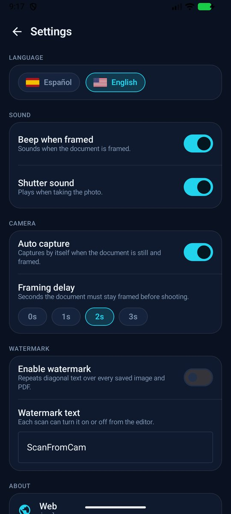

<p align="center">
  
</p>

<p align="center">
  <a href="https://github.com/JaMoLpE88/ScanFromCam"></a>
  <a href="LICENSE"></a>
  
  
  
</p>

<h1 align="center">ScanFromCam</h1>

<p align="center">
  <b>English</b> · <a href="README.es.md">Español</a>
</p>

<p align="center">
  Turn your phone camera into a document scanner: capture, straighten, clean and
  export to image or searchable PDF. Free, open source, offline, no ads, no
  accounts, no limits.
</p>

---

## What it does

Point the camera at a sheet of paper. ScanFromCam finds its four corners, keeps
the frame steady until the shot is safe, and gives you the page on a dark canvas
where you can fix the crop, rotate it, recognise its text and pick the finish:
**Original** (as captured) or **Optimize** (cleaned like a real scan). Pages
stack into a document you can save as one JPG per page or as a PDF with a
selectable text layer.

Everything happens on the device. The app does not even request the
`INTERNET` permission.

<p align="center">
  
  
  
</p>
<p align="center">
  <em>Library · live edge detection and auto capture · editor with the optimized finish</em>
</p>

## Screens

<table>
  <tr>
    <td align="center"><br><sub>Pick image or PDF</sub></td>
    <td align="center"><br><sub>Drag a corner or a whole side</sub></td>
    <td align="center"><br><sub>2.5× magnifier under the finger</sub></td>
    <td align="center"><br><sub>Name it and save</sub></td>
  </tr>
  <tr>
    <td align="center"><br><sub>Read, share or open the PDF</sub></td>
    <td align="center"><br><sub>Rename, share, delete</sub></td>
    <td align="center"><br><sub>Language, sound, auto capture</sub></td>
    <td align="center"><br><sub>Original vs Optimize</sub></td>
  </tr>
</table>

## Features

**Capture**

- Live edge detection on the full camera frame, with a corner-smoothed quad that
  does not jitter.
- Auto capture: the frame turns green when the page is framed and covered, waits
  the delay you choose (0–3 s) and shoots. It pauses while the phone moves, so it
  never takes a blurred photo.
- Manual shutter always available; beep and shutter sound can be turned off.

**Edit**

- Crop with four corner handles or by dragging a whole side, both moving the
  edge it belongs to, with a 2.5× magnifier that follows your finger.
- Rotate, retake, add more pages, remove the ones you do not want.
- Original / Optimize per page, computed on demand so the editor opens instantly.
- Text extraction on device, then copy the text or keep it for the PDF.

**Optimize** — the photo-to-scan pass, in this order:

1. estimate the room illumination and divide it out;
2. pin the black and white points to this page's ink and paper, which also
   neutralises a colour cast;
3. stretch the tone curve, lift the highlights and sharpen only where there is
   an edge, so plain paper stays flat;
4. bring the chroma back, because flattening luminance washes colour out.

**Save and share**

- One JPG per page, or a PDF whose text layer is really selectable and
  searchable (invisible text drawn over the image).
- Name the document, share it, rename it, open the PDF, delete it.

**Privacy**

- No `INTERNET` permission: the app cannot upload anything, by construction.
- No accounts, no analytics, no crash reporting, no ad SDK.
- Documents live in the app's private storage and never leave the device unless
  you share them yourself.

## Free means free

- **No ads.** Not a banner, not a splash, not a "watch a video to unlock".
- **No subscription, no credits, no paywall.** Every feature in this repository
  is available to everyone.
- **No page or document limits.** Scan 2 pages or 200.
- **No forced watermark.** There is an optional diagonal stamp you can switch on
  and write yourself; it is **off by default** and the page is yours.
- **Open source.** Apache-2.0: read it, build it, fork it, ship it.

## Languages

The UI ships in **English** and **Spanish**, and can be switched at runtime from
Settings. More languages are a `Texts` implementation away
(`core/Texts.kt`).

<table>
  <tr>
    <td align="center"><br><sub>Español</sub></td>
    <td align="center"><br><sub>Español</sub></td>
    <td align="center"><br><sub>Español</sub></td>
  </tr>
</table>

## Download

Signed APKs are attached to every [release](https://github.com/JaMoLpE88/ScanFromCam/releases):

- `ScanFromCam-1.0.0-arm64-v8a.apk` — phones and tablets (almost every current device).
- `ScanFromCam-1.0.0-x86_64.apk` — emulators and x86 tablets.

Download the APK and open it on the phone; Android will ask to allow installs from that
source. No store account, no sign-up.

## Build

Requirements: JDK 21 and Android SDK 37. Point the build at your SDK with `sdk.dir` in
`local.properties` (Android Studio writes it) or the `ANDROID_HOME` environment variable.

```bash
git clone https://github.com/JaMoLpE88/ScanFromCam.git
cd ScanFromCam
./gradlew :app:assembleDebug
```

The release build is minified and produces one APK per ABI (the OpenCV native
library is big, so `arm64-v8a` and `x86_64` are built separately). For a quick installable
build signed with the debug key:

```bash
./gradlew :app:assembleStaging
```

## Tests

- `./gradlew :app:testDebugUnitTest` — 54 unit tests: quad geometry and ordering,
  quad smoothing, stability window, capture gating, crop handles, rotation,
  watermark layout, file naming, language detection.
- `./gradlew :app:connectedDebugAndroidTest` — 15 instrumented tests: detection on
  synthetic photos, corner refinement, the whole capture → crop → optimize
  pipeline, PDF with and without a text layer, and streaming builds of large
  PDFs.

## Project layout

```
app/src/main/java/com/scanfromcam/
  core/            names, images, language, texts, watermark, sounds
  domain/          models, quad geometry, repository contract
  data/            OpenCV pipeline, SQLite, OCR, PDF
  feature/
    library/       documents and thumbnails
    format/        image or PDF
    capture/       camera, live detection, auto capture
    editor/        crop, magnifier, finishes, text
    viewer/        read, share, rename, delete
  ui/theme/        design tokens
```

## How the scanning works

- **Detection** (`data/Cv.kt`): two independent candidate generators, edge contours
  and the bright page blob, scored by area, rectangularity, real edge support,
  paper brightness and contrast against the surroundings; clipped quads are
  rejected because a sheet is fully inside the frame.
- **Rectification**: total-least-squares line fit per side, re-intersection of
  the four lines, then a perspective warp with a prefilter when shrinking so
  thin strokes do not alias.
- **Optimize**: the illumination / white point / local contrast / chroma pass
  described above.
- **OCR**: ML Kit text recognition on device, then an invisible text layer in the
  PDF.

## Third-party

AndroidX, Jetpack Compose, CameraX (Apache-2.0) · OpenCV 4 (Apache-2.0) ·
ML Kit Text Recognition (Google terms) · Coil (Apache-2.0).

## License

[Apache License 2.0](LICENSE) © 2026 JaMoLpE88.
